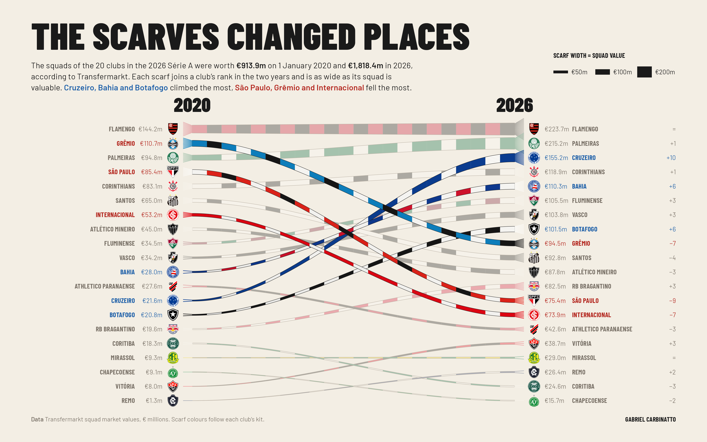

# The scarves changed places

## Summary

Ranks the 20 clubs of the 2026 Campeonato Brasileiro Série A by the Transfermarkt market value of their squads on 1 January 2020 and in 2026, and draws each club as a supporters' scarf in its colours, running from its 2020 rank to its 2026 rank and as wide as its squad is valuable. The result is a single landscape chart (16:10), `viz/brazilian-clubs-squad-value-evolution.png`:

- **Total value.** The 20 squads together went from €913.9m to €1,818.4m.
- **Climbers.** Cruzeiro rose 10 places (13th to 3rd), Bahia and Botafogo 6 each.
- **Fallers.** São Paulo dropped 9 places (4th to 13th), Grêmio and Internacional 7 each.



## Method

- **Ranking.** Each club's position is its rank by squad value in each year, highest first. There are no ties.
- **Scarves.** Each scarf's width moves linearly from the 2020 value to the 2026 value, so a widening scarf is a squad that gained value. The stripes approximate each club's kit, with a fringe at both ends.
- **Highlight.** The three clubs that gained the most places are blue and the three that lost the most are red. The other 14 are faded into the paper as context.

## Structure

- `R/squad-value-chart.R`: the scarves (polygons knitted block by block), with ggplot2, ggimage for the crests and ggtext.
- `data/processed/brazilian_clubs_squad_values.csv`: squad values in € millions for both dates.
- `assets/team-logos/`: club crests.
- `assets/fonts/`: Barlow and Barlow Condensed, with their OFL licence.
- `viz/`: final chart.

## Running

The script runs from the project root:

```bash
Rscript -e 'install.packages(c("dplyr", "ggimage", "ggplot2", "ggtext", "purrr", "ragg", "readr", "scales", "stringr", "systemfonts", "tidyr"))'
Rscript R/squad-value-chart.R
```

## Outputs

| file                                               | content                                            |
| -------------------------------------------------- | -------------------------------------------------- |
| `data/processed/brazilian_clubs_squad_values.csv`  | one club per row, with both values and crest file  |
| `viz/brazilian-clubs-squad-value-evolution.png`    | the chart, 32 × 20 cm at 300 dpi                   |
